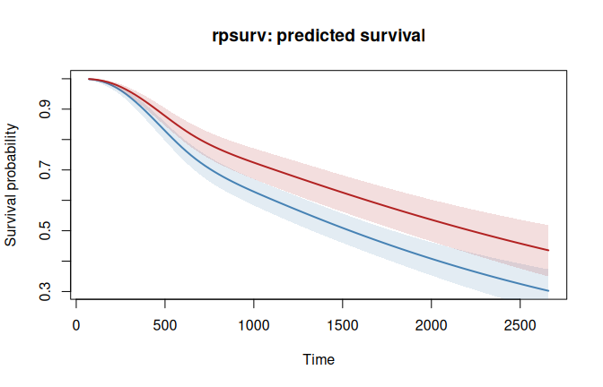
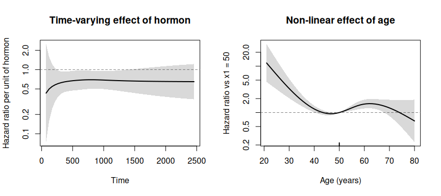

<!-- README.md is generated from README.Rmd. Please edit that file -->

# rpsurv

<!-- badges: start -->

[](https://CRAN.R-project.org/package=rpsurv)
[](https://github.com/ielbadisy/rpsurv/actions/workflows/R-CMD-check.yaml)
[](https://opensource.org/licenses/MIT)
<!-- badges: end -->

`rpsurv` fits the Royston and Parmar (2002) family of flexible
parametric survival models: the baseline distribution is a restricted
cubic spline in log time on a chosen transformed scale (proportional
hazards, proportional odds, or probit), which gives a smooth, fully
parametric, extrapolable fit without committing to a Weibull,
log-normal, or other single distribution. Covariate effects can vary
over time (`tve`) and be non-linear in the covariate itself (`nle`),
each with its own spline.

The log-likelihood and its analytic gradient are evaluated in C++ via
`RcppParallel`, so fitting stays fast at large sample sizes (see the
Benchmark section below). Output mirrors `coxph()`:
`print()`/`summary()` separate interpretable covariate effects from the
baseline spline nuisance parameters, and there are
`predict()`/`plot()`/residual-diagnostic methods.

All results below are real output from the bundled `brcancer` data (686
rows, 299 events).

## Installation

``` r
# CRAN release:
install.packages("rpsurv")

# development version:
# install.packages("remotes")
remotes::install_github("ielbadisy/rpsurv")
```

## Fitting a model

``` r
library(rpsurv)
library(survival)

data(brcancer)
brcancer$hormon <- as.numeric(brcancer$hormon)

fit <- rpsurv(Surv(rectime, censrec) ~ hormon, data = brcancer, df = 4, scale = "hazard")
fit
#> Royston-Parmar flexible parametric survival model
#> Call:
#> rpsurv(formula = Surv(rectime, censrec) ~ hormon, data = brcancer, 
#>     df = 4, scale = "hazard")
#> 
#> Scale: hazard   Baseline df: 4   
#> n = 686 , number of events = 299 
#> Log-likelihood = -2606   AIC = 5225

summary(fit)
#> Royston-Parmar flexible parametric survival model
#> Call:
#> rpsurv(formula = Surv(rectime, censrec) ~ hormon, data = brcancer, 
#>     df = 4, scale = "hazard")
#> 
#> Covariate effects (hazard scale):
#>           coef exp(coef) [HR] se(coef)      z Pr(>|z|)   
#> hormon -0.3641         0.6948   0.1249 -2.914  0.00356 **
#> ---
#> Signif. codes:  0 '***' 0.001 '**' 0.01 '*' 0.05 '.' 0.1 ' ' 1
#> 
#> Baseline spline terms:
#>                   coef  exp(coef)   se(coef)      z Pr(>|z|)
#> (Intercept) -1.960e+01  3.086e-09  3.257e+00 -6.016 1.79e-09
#> s(logt)1     2.993e+00  1.994e+01  5.966e-01  5.016 5.26e-07
#> s(logt)2    -4.429e-01  6.422e-01  5.711e-01 -0.776   0.4380
#> s(logt)3     1.357e+00  3.884e+00  8.188e-01  1.657   0.0974
#> s(logt)4    -8.841e-01  4.131e-01  4.176e-01 -2.117   0.0342
#> 
#> n = 686 , number of events = 299 , parameters = 6 
#> Log-likelihood = -2606   AIC = 5225   BIC = 5247
```

The summary keeps the interpretable covariate hazard ratio (`hormon`)
separate from the baseline spline coefficients, which describe the shape
of the baseline hazard and are not individually interpretable, matching
`rstpm2`/`flexsurv` convention.

## Prediction and plotting

``` r
predict(fit, newdata = data.frame(hormon = c(0, 1)), times = c(500, 1000, 2000), type = "survival")
#>   id time       est
#> 1  1  500 0.8287000
#> 2  1 1000 0.6284960
#> 3  1 2000 0.4078301
#> 4  2  500 0.8776041
#> 5  2 1000 0.7241878
#> 6  2 2000 0.5362198

plot(fit, newdata = data.frame(hormon = c(0, 1)),
     col = c("steelblue", "firebrick"), main = "rpsurv: predicted survival")
```



`predict()` also returns `type = "hazard"`, `"cumhaz"`, `"link"` (the
linear predictor), or `"hr"` (the instantaneous hazard ratio of
`newdata` versus `newdata0`, correct under time-varying effects), with
`se.fit = TRUE` adding delta-method 95% confidence limits for
`"survival"`, `"cumhaz"`, and `"link"`. `rmst_diff()` gives the
difference in restricted mean survival time between two covariate
profiles, with a delta-method confidence interval:

``` r
rmst_diff(fit, newdata = data.frame(hormon = 1), newdata0 = data.frame(hormon = 0),
          tau = 2000, se.fit = TRUE)
#>       est      se    lower    upper
#> 1 161.595 53.5285 56.68104 266.5089
```

## Time-varying effects (non-proportional hazards)

A covariate’s *value* is fixed for a subject, but its *coefficient* can
be allowed to change over follow-up via its own spline in log time,
requested with `tve`:

``` r
fit_tve <- rpsurv(Surv(rectime, censrec) ~ hormon, data = brcancer,
                  df = 4, tve = "hormon", tve.df = 2)
coef(fit_tve)
#>     (Intercept)        s(logt)1        s(logt)2        s(logt)3        s(logt)4 
#>    -19.19777720      2.93098413     -0.42391914      1.32597578     -0.87854493 
#>          hormon hormon:s(logt)1 hormon:s(logt)2 
#>     -2.34822990      0.32187562      0.03601483
```

A likelihood-ratio test of `fit_tve` against `fit` (both
maximum-likelihood fits, nested models) tests the proportional-hazards
assumption for `hormon` directly.

This is distinct from a **time-varying covariate**, where the
covariate’s *value itself* changes during follow-up. That is a
data-representation question, not a modeling one: split each subject’s
follow-up into intervals over which the covariate is constant and supply
counting-process data via `Surv(start, stop, status)`. `rpsurv` detects
the 3-column `Surv` object and fits the left-truncated likelihood
automatically, correctly accounting for each interval’s dependence on
survival to its start time under the covariate value of the *previous*
interval. The same mechanism also handles ordinary left truncation
(delayed entry) when covariate values don’t change. See
`vignette("rpsurv")` for a full worked example and the underlying
likelihood.

## Non-linear effects and effect curves

`nle` gives a numeric covariate a smooth non-linear effect g(x), a
restricted cubic spline in the covariate with `nle.df` degrees of
freedom (`nle.df = 1` is the linear fit). It is specified separately
from `tve`, and a covariate may have both. `tve.df` and `nle.df` take a
single value or a vector named by covariate. Here age (`x1`) enters
non-linearly and `hormon` keeps its time-varying effect:

``` r
fit_nle <- rpsurv(Surv(rectime, censrec) ~ hormon + x1, data = brcancer,
                  df = 4, tve = "hormon", tve.df = 2, nle = "x1", nle.df = 3)
```

`tvecurve()` returns the time-varying effect (by default the log
instantaneous hazard ratio per unit increase, `type = "hr"`; or the
coefficient function beta(t), `type = "link"`), and `nlecurve()` returns
g(x) - g(ref). Both come with delta-method 95% confidence limits:

``` r
tvecurve(fit_nle, "hormon", times = c(500, 1000, 2000))
#>   time        est        se      lower       upper
#> 1  500 -0.3990412 0.1802440 -0.7523129 -0.04576955
#> 2 1000 -0.3749970 0.1652673 -0.6989149 -0.05107912
#> 3 2000 -0.4262817 0.2810372 -0.9771045  0.12454116

nlecurve(fit_nle, "x1", at = c(30, 40, 50, 60, 70), ref = 50)
#>    x       est         se       lower     upper
#> 1 30 1.1933311 0.24685222  0.70950961 1.6771525
#> 2 40 0.1777640 0.08409718  0.01293659 0.3425915
#> 3 50 0.0000000 0.00000000  0.00000000 0.0000000
#> 4 60 0.4227621 0.11179080  0.20365612 0.6418680
#> 5 70 0.2303089 0.20586941 -0.17318769 0.6338056
```

Their `plot()` methods draw the hazard ratio against time or against the
covariate, with its confidence band, a reference line at no effect and a
log y axis (`add = TRUE` overlays curves):

``` r
op <- par(mfrow = c(1, 2))
plot(tvecurve(fit_nle, "hormon"), main = "Time-varying effect of hormon")
plot(nlecurve(fit_nle, "x1", ref = 50), xlab = "Age (years)",
     main = "Non-linear effect of age")
```



``` r
par(op)
```

## Diagnostics

``` r
residuals(fit, type = "coxsnell")   # also "martingale", "deviance"
coxsnell_plot(fit)                  # Cox-Snell residual plot
km_compare_plot(fit)                # fitted vs. Kaplan-Meier overlay
```

## Validation

Coefficients, standard errors, and log-likelihoods agree with
`rstpm2::stpm2` to 4-5 decimal places across all three scales (`hazard`,
`odds`, `normal`) and with `flexsurv::flexsurvspline` on the hazard
scale. See `tests/testthat/test-rpsurv.R` for the full parity suite,
which also covers left truncation, and
`tests/testthat/test-components.R` for the `nle`, `tvecurve()` and
`nlecurve()` checks.

## Benchmark vs. `rstpm2` and `flexsurv`

Wall-clock fit time on simulated Weibull-hazard data with two
covariates, reproducible via `data-raw/benchmark.R` (in the GitHub
repository, not in the CRAN tarball). `flexsurv::flexsurvspline` is
materially slower per fit, so it was only run up to n=2e4 to keep the
benchmark tractable; `rstpm2::stpm2` was run up to n=2e5.

|       n | rpsurv (s) | rstpm2 (s) | flexsurvspline (s) |
|--------:|-----------:|-----------:|-------------------:|
|   1,000 |      0.031 |      0.017 |              0.121 |
|   5,000 |      0.037 |      0.058 |              0.636 |
|  20,000 |      0.080 |      0.238 |              2.330 |
|  50,000 |      0.165 |      1.290 |                 \- |
| 100,000 |      0.247 |      2.410 |                 \- |
| 200,000 |      0.413 |      4.912 |                 \- |
| 500,000 |      1.182 |         \- |                 \- |

At n=200,000, `rpsurv` is about 12x faster than `rstpm2::stpm2` and
continues to scale to n=500,000 (`rstpm2` was not run at that size). At
n=20,000, `rpsurv` is about 29x faster than `flexsurv::flexsurvspline`.
The advantage widens with n in both comparisons: `rpsurv` does O(n) work
per optimizer step in a single fused parallel pass over the
log-likelihood and its analytic gradient, computed together
(`RcppParallel::parallelReduce`), against repeated R-level likelihood
evaluation (numerical gradients, or gradients built from R-level matrix
algebra) in the other two packages. See `vignette("rpsurv")` for the
full benchmark code and what else is delegated to C++ (the spline basis
itself, and closed-form starting values from a bounded Kaplan-Meier
subsample).

## Bundled datasets

`rpsurv` ships three datasets, each chosen for a specific feature of the
package rather than as a generic example:

- `brcancer`: German breast cancer recurrence data (686 rows), the
  baseline fitting example used throughout this README and the vignette.
  Identical to `rstpm2::brcancer`, bundled so examples do not require
  `rstpm2` to be installed.
- `veteran`: Veterans’ Administration lung cancer trial (137 rows).
  `celltype` is a well-known non-proportional-hazards effect, which
  makes this a direct illustration of the `tve` argument. Identical to
  `survival::veteran`.
- `heart`: Stanford heart transplant data (172 rows), already in
  counting-process (`start`, `stop`, `event`) format with a time-varying
  `transplant` covariate. Illustrates `Surv(start, stop, status)`
  fitting on a real dataset rather than a constructed one. Identical to
  `survival::heart`.

## Notes

- `scale` selects the transformation of the survival function the spline
  models: `"hazard"` (proportional hazards, the Royston-Parmar default),
  `"odds"` (proportional odds), or `"normal"` (probit).
- Boundary knots default to the min/max of log time among events, and
  interior knots to equally spaced centiles of log time among events,
  matching `rstpm2`/`flexsurv` conventions. `nle` knots are placed the
  same way on the covariate (range and equally spaced centiles).
- `SystemRequirements: GNU make` (for `RcppParallel`); no other external
  dependencies.
